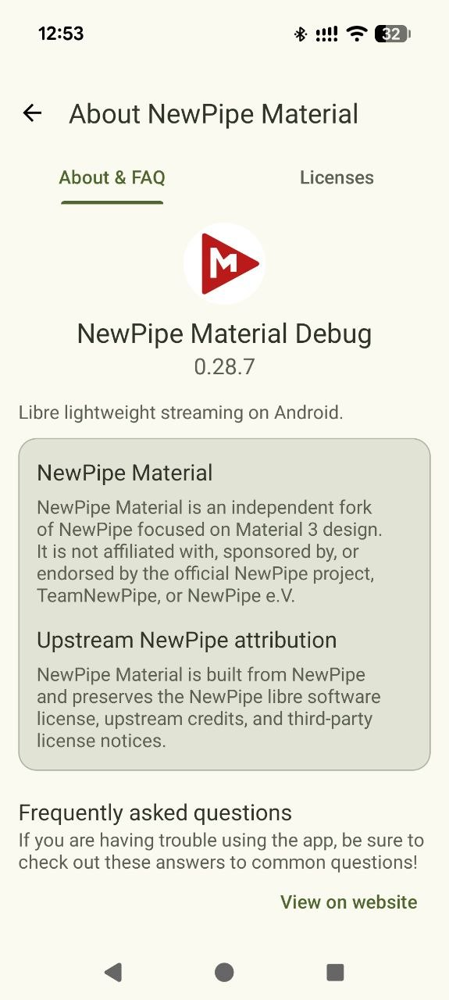
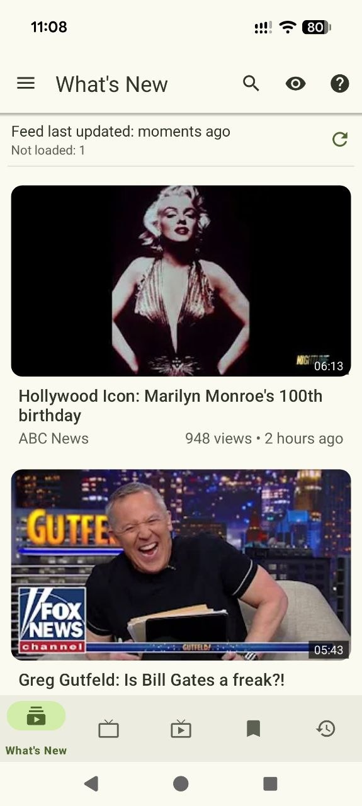
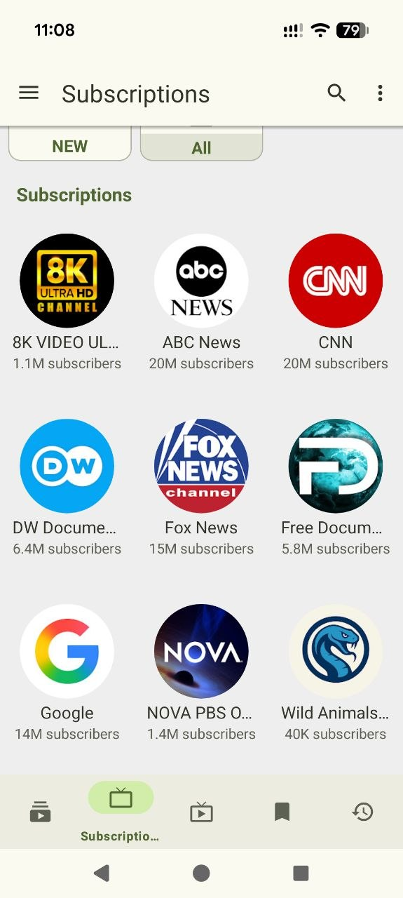
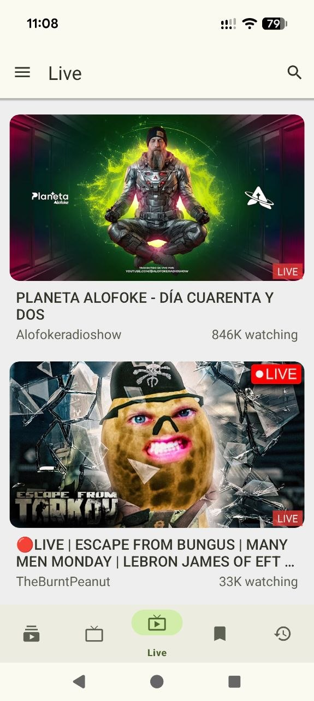
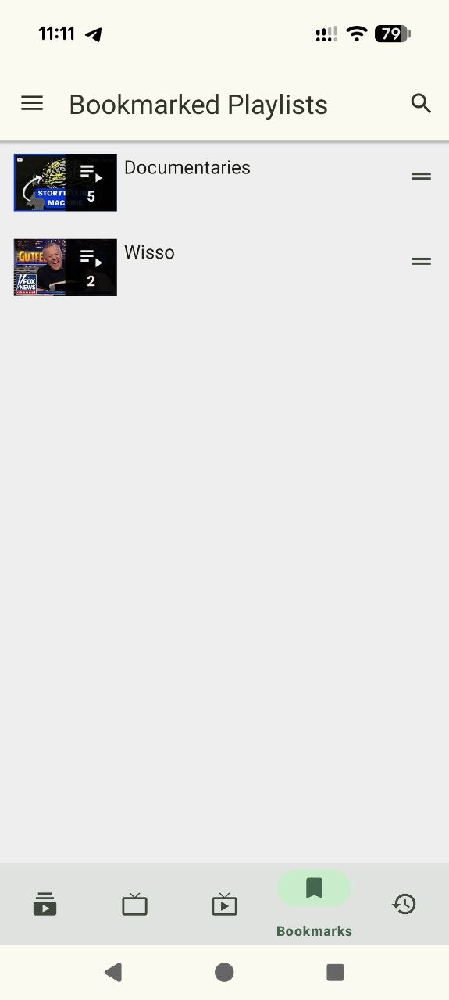
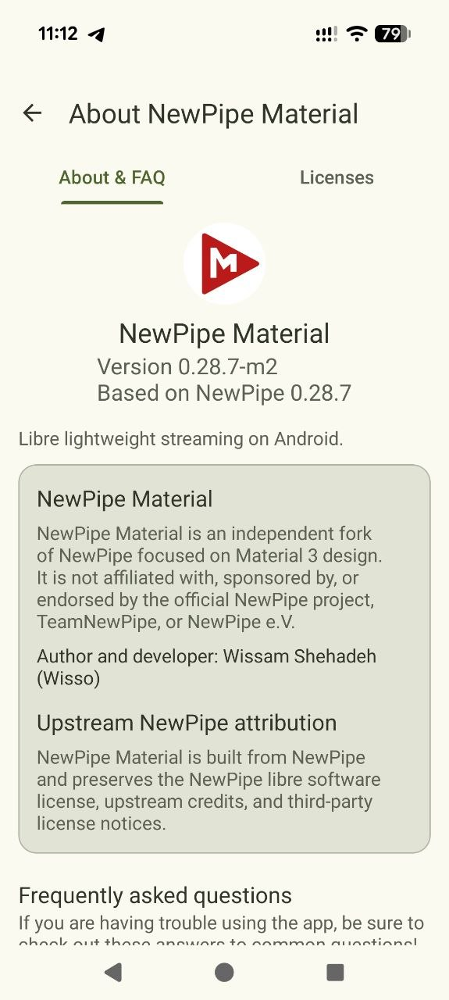
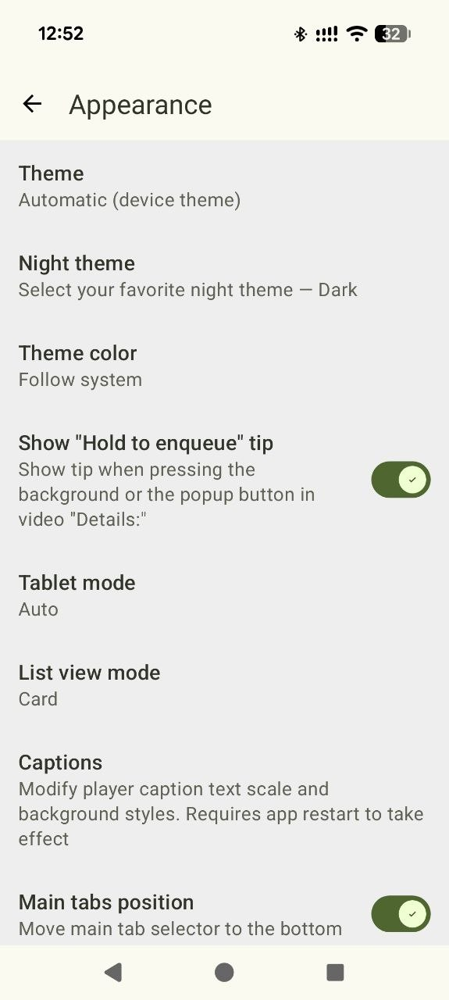
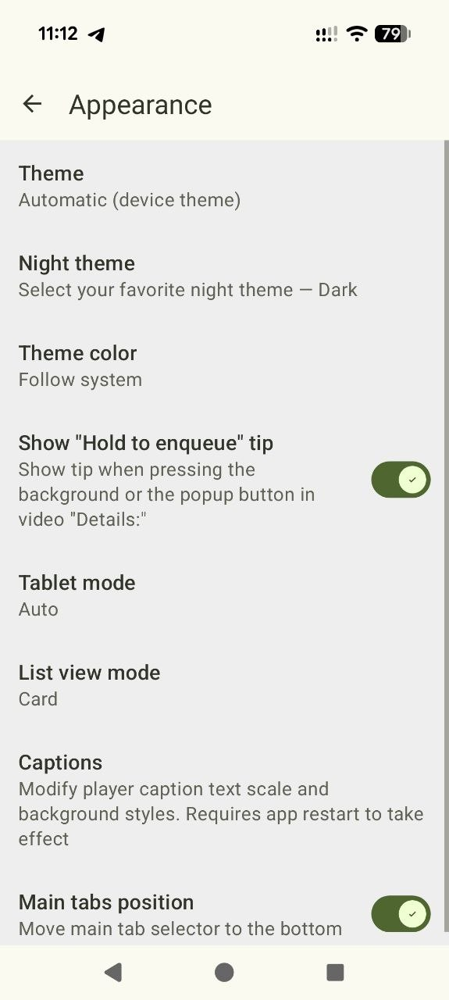
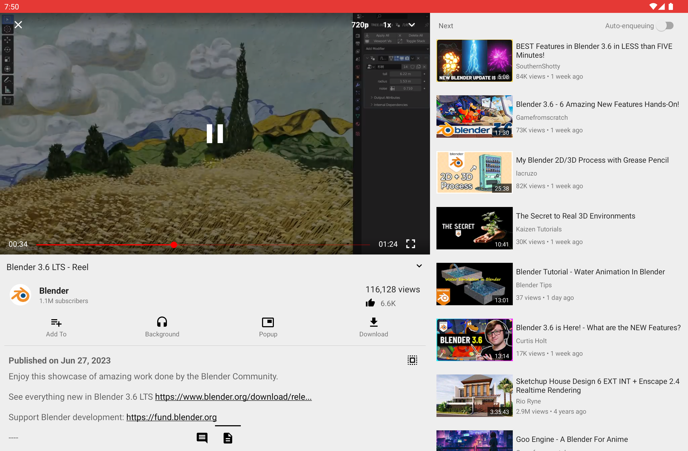
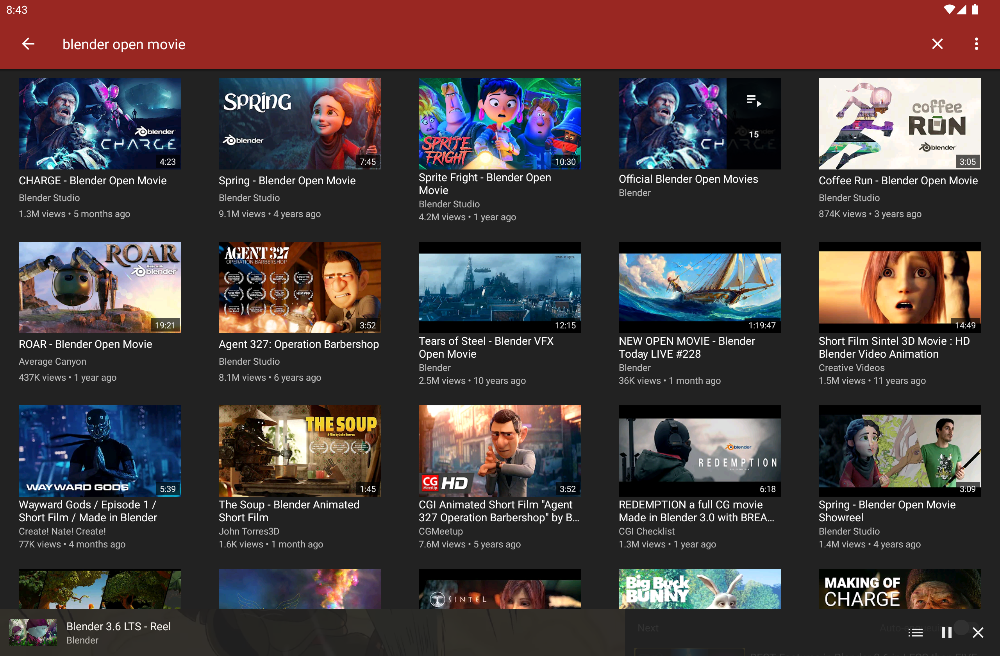

<p align="center"><a href="https://github.com/wizdom13/WizeStream"></a></p>

<h1 align="center">WizeStream</h1>

<p align="center"><b>An independent, privacy-friendly NewPipe-based streaming client for Android.</b></p>

<p align="center">
  <a href="https://apt.izzysoft.de/packages/org.wisso.newpipematerial"></a>
  <a href="https://github.com/wizdom13/WizeStream/releases"></a>
  <br>
  <a href="https://github-store.org/app?repo=wizdom13/WizeStream"></a>
</p>

<p align="center">
  <a href="https://www.gnu.org/licenses/gpl-3.0"></a>
  <a href="https://github.com/wizdom13/WizeStream/actions"></a>
  <a href="https://apt.izzysoft.de/packages/org.wisso.newpipematerial"></a>
  <a href="https://shields.rbtlog.dev/org.wisso.newpipematerial"></a>
</p>

<p align="center">
  <a href="https://wizestream.org/reviews/"></a>
</p>

<p align="center">
  <a href="https://dlstats.izzyondroid.org/#app-trends?app=org.wisso.newpipematerial&amp;clients=_total&amp;agg=daily"></a>
  <a href="https://github.com/wizdom13/WizeStream/releases"></a>
  <a href="https://wizestream.org/downloads.html"></a>
</p>

<p align="center">
  <a href="https://wizestream.org/downloads.html"></a>
</p>

<hr>

<p align="center">
  <a href="#important-project-notice">Project notice</a> •
  <a href="#what-is-wizestream">About</a> •
  <a href="#screenshots">Screenshots</a> •
  <a href="#supported-services">Services</a> •
  <a href="#feature-comparison">Comparison</a> •
  <a href="#features">Features</a> •
  <a href="#android-auto">Android Auto</a> •
  <a href="#device-synchronization">Device sync</a> •
  <a href="#installation">Installation</a> •
  <a href="#building-from-source">Build</a> •
  <a href="#release-signing">Signing</a> •
  <a href="#development-status">Development</a> •
  <a href="#contributing">Contributing</a> •
  <a href="#upstream-newpipe">Upstream</a> •
  <a href="#star-history">Star History</a> •
  <a href="#license">License</a>
</p>

<p align="center">Translations are welcome, but only native-speaker reviewed translations will be added.</p>

---

## Important project notice

WizeStream is an independent, NewPipe-based streaming client for Android. It combines a modern
Material 3 Expressive interface with privacy-friendly playback, useful local-first features, and
support for multiple streaming platforms.

WizeStream maintains its own application and integrated extractor changes. It is **not affiliated
with, sponsored by, or endorsed by** the official NewPipe project, TeamNewPipe, or NewPipe e.V.

WizeStream preserves the NewPipe libre software license, upstream credits, and third-party license notices.

- [Documentation index](docs/README.md)
- [Frequently asked questions](docs/faq.md)
- [Privacy policy](PRIVACY.md)

### Rebranding from NewPipe Material

WizeStream was previously called **NewPipe Material**. The new name distinguishes this
independently maintained app from official NewPipe. See [issue #34](https://github.com/wizdom13/WizeStream/issues/34)
for the original rebranding request.

Existing NewPipe Material users can update normally with a release signed by the same key:
the application ID remains unchanged, and the rename does not reset local data or settings.
Upstream attribution, licensing, and third-party notices are preserved.

### Independent versioning

WizeStream has its own release cycle and follows semantic versioning:

- `MAJOR.MINOR.PATCH`, such as `1.0.0`, `1.1.0`, and `1.2.0`
- Git tags use the corresponding `vMAJOR.MINOR.PATCH` form
- WizeStream version numbers do not contain or follow NewPipe version numbers

NewPipe remains an upstream source and is credited as required, but its version is development
metadata rather than part of WizeStream's public version identity. The currently tracked upstream
baseline is recorded in [UPSTREAM.md](UPSTREAM.md).

---

## What is WizeStream?

WizeStream keeps the lightweight, privacy-friendly NewPipe experience while developing its own
interface, playback, discovery, synchronization, and service-support features. Material 3
Expressive design remains an important project goal, but it is one part of a broader independent
client rather than the project's only purpose.

Project highlights:

- Material 3-inspired design with Material You colors, manual color presets, and customizable navigation
- Account-free playback, subscriptions, feeds, playlists, downloads, and history across supported services
- Local profiles for separate Personal, Work, Study, or other contexts without platform accounts
- Dedicated YouTube Music and YouTube Shorts destinations, advanced search filters, and channel sorting
- Main, background, and popup playback with advanced gestures, a sleep timer, multi-audio selection,
  and per-channel playback profiles
- SponsorBlock, YouTube dislike counts, and clear handling for members-only videos
- Local blocking for videos, channels, and title or uploader keywords, plus contextual search inside
  channel tabs and playlists
- Bulk playlist and queue downloads with embedded media metadata
- Optional DeArrow titles and thumbnails, and open TV casting to FCast and Chromecast-compatible
  receivers on Android 8 and newer
- Optional Learning Mode with timestamped notes, playlist progress, study statistics, and a dashboard
- Secure peer-to-peer synchronization between trusted WizeStream devices, manually or automatically
  over Wi-Fi or Ethernet
- Searchable transcripts, timestamped notes, smart playlists, and explicit playback-queue recovery
- Automatic channel downloads with opt-in offline retention and permanent file protection
- Local search across subscriptions, playlists, feeds, history, and Downloads
- Import/export compatibility with supported NewPipe backup data and a verified in-app update flow

This README describes the current `pipe` branch; recently merged features may arrive in the next
release. See the [release history](docs/changelogs.md) and [published releases](https://github.com/wizdom13/WizeStream/releases)
for version-specific availability.

The latest release checked for this documentation is
[**WizeStream 1.52.2 (25 November 2026)**](https://github.com/wizdom13/WizeStream/releases/tag/v1.52.2).
The source review covers `pipe` at
[`983d8acb`](https://github.com/wizdom13/WizeStream/tree/983d8acb0cdd934a2a0fbe747020bb988b2b52b0)
(25 November 2026), the same commit as the `v1.52.2` release tag. Features in this reviewed snapshot
are included in that release; later commits and open pull requests are outside the snapshot.
See the [release availability page](https://wizestream.org/releases.html) for version-specific details.

---

## Screenshots

### Phone

<p align="center">
  <a href="fastlane/metadata/android/en-US/images/phoneScreenshots/01.png"></a>
  <a href="fastlane/metadata/android/en-US/images/phoneScreenshots/02.png"></a>
  <a href="fastlane/metadata/android/en-US/images/phoneScreenshots/03.png"></a>
  <a href="fastlane/metadata/android/en-US/images/phoneScreenshots/04.png"></a>
  <a href="fastlane/metadata/android/en-US/images/phoneScreenshots/05.png"></a>
  <a href="fastlane/metadata/android/en-US/images/phoneScreenshots/06.png"></a>
  <a href="fastlane/metadata/android/en-US/images/phoneScreenshots/07.png"></a>
  <a href="fastlane/metadata/android/en-US/images/phoneScreenshots/08.png"></a>
  <a href="fastlane/metadata/android/en-US/images/phoneScreenshots/09.png"></a>
  <a href="fastlane/metadata/android/en-US/images/phoneScreenshots/10.png"></a>
  <a href="fastlane/metadata/android/en-US/images/phoneScreenshots/11.png"></a>
  <a href="fastlane/metadata/android/en-US/images/phoneScreenshots/12.png"></a>
</p>

### Tablet

<p align="center">
  <a href="fastlane/metadata/android/en-US/images/tenInchScreenshots/09.png"></a>
  <a href="fastlane/metadata/android/en-US/images/tenInchScreenshots/10.png"></a>
</p>

---

## Supported services

WizeStream supports these services through extractor source integrated directly into the app:

- YouTube, including dedicated YouTube Music and YouTube Shorts destinations
- SoundCloud
- media.ccc.de
- PeerTube
- Bandcamp
- Bilibili
- Niconico
- BitChute
- Rumble
- Odysee (experimental)
- Vimeo (public videos, shared unlisted links, creators/channels, Staff Picks, showcases and live events)

For Vimeo, use **Open link** or share a video, channel, showcase/album or event URL to WizeStream.
Public showcases open as playlists; event links follow the broadcast or recording Vimeo selects.
Native playback supports the unencrypted streams Vimeo exposes, with captions when available.
Downloads require a progressive video file. Keep the full URL when sharing an unlisted video so
its access hash is retained.

Global keyword search and reading public video comments/replies require an optional **public-only
Vimeo API token** in **Settings > Content > Vimeo**. **Search Vimeo** stays visible and offers
direct setup when needed, preserving the query when you return. The user supplies a token from their own Vimeo
API app; WizeStream verifies its scope and stores it encrypted on the device, outside backups and
Device Sync. No shared credential is included in the app. Normal public playback, showcases and
events do not require it. Account sign-in, posting comments, live chat and protected videos remain
unsupported. See the [Vimeo setup guide](docs/faq.md#how-do-i-use-vimeo).

YouTube playback and downloads use conventional progressive, DASH, and HLS stream URLs exposed by
the bundled extractor source.

### Integrated extractor lineage and responsibility

The bundled extractor is derived from NewPipeExtractor and later incorporated PipePipeExtractor
and WizeStream-specific changes. It is maintained as source inside WizeStream and is therefore
neither the unmodified official NewPipeExtractor nor an external PipePipeExtractor dependency.

Extractor work is part of WizeStream's current scope because service compatibility and playback
fixes can require coordinated application, player, and extractor changes.
Problems encountered in WizeStream—including service and extractor failures—should be reported to
WizeStream first. Comparing a problem with official NewPipe can help determine whether the cause is
shared upstream, but WizeStream remains responsible for defects caused by its bundled changes.

---

## Feature comparison

Selected Android features as of November 2026. **—** means support was not verified in the
linked project documentation, source, or release notes. **Inherited** refers to a documented
NewPipe capability retained in BravePipe's NewPipe-based app. Service coverage and availability
can vary by version, build, and provider.

### Streaming services and discovery

| Feature | WizeStream | [NewPipe][comparison-newpipe] | [PipePipe][comparison-pipepipe] | [BravePipe][comparison-bravepipe] |
| --- | --- | --- | --- | --- |
| YouTube streaming without signing in | Yes | Yes | Yes | Yes |
| YouTube Music | Dedicated Music destination | Supported | YouTube music player mode | Inherited from NewPipe |
| SoundCloud, PeerTube, Bandcamp, media.ccc.de | All four | All four | SoundCloud and PeerTube documented | Inherited from NewPipe |
| Bilibili and Niconico | Both | — | Both, including documented live features | — |
| BitChute and Rumble | Both | — | — | Both |
| Odysee | Experimental | — | — | — |
| YouTube account sign-in | No | No | Optional for restricted or premium content | — |
| SponsorBlock | Per-category controls and offline skipping for supported downloads | [No][comparison-newpipe-sponsorblock] | YouTube and Bilibili | Yes, via NewPipe x SponsorBlock |
| YouTube dislike counts | Optional | — | ReturnYouTubeDislike | — |
| DeArrow titles and thumbnails | Optional | — | [Available][comparison-pipepipe-55] | — |
| Live chat and danmaku | Read-only YouTube chat tab, fullscreen panel, and danmaku | — | [Chat tab and danmaku][comparison-pipepipe-55] | — |

### Local media, Live TV, and Live Radio

| Feature | WizeStream | [NewPipe][comparison-newpipe] | [PipePipe][comparison-pipepipe] | [BravePipe][comparison-bravepipe] |
| --- | --- | --- | --- | --- |
| Browse and play device audio and video | Local Media browser with search, filters, folders, exclusions, and rescans | — | — | — |
| Local-file playback modes | Main player, background audio, and popup | — | — | — |
| Live TV channel directory | Worldwide country browser with IPTV-org by default and optional Free-TV | — | — | — |
| Live TV playlist imports | M3U files and HTTPS playlist URLs, plus custom channel URLs | — | — | — |
| Live TV search and organization | Channel search with a contextual search button, group and playlist filters, logos, and favorites | — | — | — |
| Live TV cache and refresh | Cached country lists, refresh when lists are over a day old on opening or resuming, and manual refresh | — | — | — |
| Live TV playback | Existing video player with fullscreen, TV remote controls, and manual alternative-stream selection | — | — | — |
| Live TV profiles | Playlists and favorites stored separately per profile | — | — | — |
| Internet radio directory | Worldwide Radio Browser stations | — | — | — |
| Radio search and filters | Station name, country, language, and genre | — | — | — |
| Radio favorites and custom streams | Favorites and custom HTTPS audio or HLS URLs | — | — | — |
| Radio miniplayer | Station logo and details, queue, play/pause, and close | — | — | — |

### Playback, gestures, and devices

| Feature | WizeStream | [NewPipe][comparison-newpipe] | [PipePipe][comparison-pipepipe] | [BravePipe][comparison-bravepipe] |
| --- | --- | --- | --- | --- |
| Background audio | Yes, with Listen mode | Yes | Yes, with music player mode | Inherited from NewPipe |
| Floating video player | Popup and optional native Android picture-in-picture | Popup | — | Inherited popup player |
| Playback speed and captions | Both, with per-channel preferences | Both | Both | Inherited from NewPipe |
| 360° video playback | Opt-in (off by default): automatic projection detection, manual equirectangular mode, drag/DPAD panning, optional motion tracking, and Recenter | — | — | — |
| Subtitle timing and A–B repeat | Session-only caption offset; opt-in non-live A–B repeat (off by default) | — | — | — |
| Audio tools | 10-band equalizer, visualizers, loudness normalization, and compression | — | — | — |
| Chapter markers in the seek bar | Markers, titles while seeking, and supported haptics | [Chapter divisions][comparison-newpipe-releases] | — | — |
| Fullscreen volume and brightness swipes | Configurable | [Configurable sides][comparison-newpipe-gestures] | — | Inherited gestures |
| Swipe to seek | Yes | — | [Available][comparison-pipepipe-seek] | — |
| Swipe down to minimize | Yes, including loading and error screens | — | [Configurable][comparison-pipepipe-releases] | — |
| Pinch to zoom and fullscreen touch lock | Both, plus two-finger panning | — | [Both][comparison-pipepipe-55] | — |
| Android TV and remote controls | TV layout, D-pad shortcuts, direct seeking, and miniplayer focus | [Android and Google TV support][comparison-newpipe-devices] | [Optimized TV controls][comparison-pipepipe-releases] | — |
| Samsung DeX and large screens | Compact playlist search cards in DeX and landscape, plus tablet layouts | Tablet layout choices | — | — |
| Android Auto | Audio browsing, voice search, and resume | [Supported][comparison-newpipe-devices] | [Supported][comparison-pipepipe-auto] | — |
| TV casting | FCast and Chromecast-compatible receivers | — | — | — |
| Home audio handoff | Optional HTTPS yt-fifo server with Snapcast; play now or queue a stream link | — | — | — |

### Profiles, privacy, and networking

| Feature | WizeStream | [NewPipe][comparison-newpipe] | [PipePipe][comparison-pipepipe] | [BravePipe][comparison-bravepipe] |
| --- | --- | --- | --- | --- |
| Local profiles | Separate subscriptions, playlists, feeds, history, and playback progress | — | — | — |
| Kids Mode and Incognito | Per-profile PIN restrictions and a separate activity-recording pause | — | — | — |
| Device synchronization | Encrypted peer-to-peer pairing and manual or scheduled sync | — | — | — |
| Synchronized library and filters | Subscriptions, playlists, progress, selected settings, and Live Radio filters | — | — | — |
| In-app proxy | HTTP or SOCKS5 with optional authentication and LAN bypass | — | — | — |
| Invidious playback option | Saved instances and explicit trust for Companion media hosts | — | — | — |

### Library, subscriptions, and downloads

| Feature | WizeStream | [NewPipe][comparison-newpipe] | [PipePipe][comparison-pipepipe] | [BravePipe][comparison-bravepipe] |
| --- | --- | --- | --- | --- |
| Account-free subscriptions and channel groups | Yes, scoped to the active profile | Yes | Yes | Inherited from NewPipe |
| Subscription feed | What’s New, group and service scopes, publication date cutoff, and progressive refresh | Feeds by channel group | Grouped subscription feed | Inherited from NewPipe |
| New-upload notifications | Configurable by channel, with keyword and network controls | Yes | — | Inherited from NewPipe |
| Local playlists and watch history | Yes, with profile separation and local search | Yes | Local playlists and history | Inherited from NewPipe |
| Playlist organization | Categories, named separators, bulk editing, and rule-based smart playlists | Local playlists | Local playlists with sorting and multi-select | Inherited local playlists |
| Swipe actions in playlists | Optional swipe to remove in Edit mode with Undo | — | [Configurable swipe actions][comparison-pipepipe-auto] | — |
| Multi-select and batch actions | Select items in search, feeds, channels, and library lists | — | [Multi-select across list pages][comparison-pipepipe-55] | — |
| Subscription import and backup | NewPipe-compatible backups and imports from Google Takeout, PipePipe, and LibreTube | [Backup export and YouTube or SoundCloud subscription import][comparison-newpipe-backup] | NewPipe backup import documented | Inherited from NewPipe |
| Scheduled local backups | Daily or weekly, with retention of the latest seven automatic backups | — | — | — |
| Video, audio, and caption downloads | Yes, with separate companion captions queued with video | Yes | Multi-format downloads and captions | Inherited from NewPipe |
| Batch downloads | Local and remote playlists and the play queue | — | Channels and playlists | — |
| Automatic subscription downloads | Hourly checks for new uploads from selected channels | — | — | — |
| Scheduled download windows | Daily time window, with optional charging and unmetered network requirements | — | — | — |
| Offline library cleanup | Optional retention rules for tracked automatic downloads | — | — | — |

### Interface, accessibility, and releases

| Feature | WizeStream | [NewPipe][comparison-newpipe] | [PipePipe][comparison-pipepipe] | [BravePipe][comparison-bravepipe] |
| --- | --- | --- | --- | --- |
| Appearance and navigation | Material 3, third-party themes, and configurable home navigation | List, grid, and card layouts | Configurable player UI and list sorting | — |
| Transcripts, notes, and Learning Mode | Searchable captions, timestamped notes, and study tools | — | — | — |
| Release channels | GitHub releases, IzzyOnDroid, and separate nightly builds | [GitHub releases, F-Droid, and official F-Droid repository][comparison-newpipe] | [GitHub stable and beta releases][comparison-pipepipe-releases] and [F-Droid][comparison-pipepipe-fdroid] | [GitHub releases][comparison-bravepipe-releases] with standard, Conscrypt, and legacy APK variants |
| In-app update flow | Manual and background checks, changelog preview, verified APK download and install handoff | Official download and F-Droid update paths documented | [In-app update checks][comparison-pipepipe-auto] | Optional integrated APK updater |

[comparison-newpipe]: https://github.com/TeamNewPipe/NewPipe
[comparison-newpipe-sponsorblock]: https://github.com/TeamNewPipe/NewPipe/discussions/10725
[comparison-newpipe-releases]: https://github.com/TeamNewPipe/NewPipe/releases/tag/v0.29.2
[comparison-newpipe-gestures]: https://github.com/TeamNewPipe/NewPipe/issues/10284
[comparison-newpipe-devices]: https://newpipe.net/FAQ/bugs/#supported-devices
[comparison-newpipe-backup]: https://newpipe.net/FAQ/tutorials/import-export-data/
[comparison-pipepipe]: https://pipepipe.dev/
[comparison-pipepipe-releases]: https://github.com/InfinityLoop1308/PipePipe/releases
[comparison-pipepipe-55]: https://github.com/InfinityLoop1308/PipePipe/discussions/3053
[comparison-pipepipe-auto]: https://github.com/InfinityLoop1308/PipePipe/discussions/1315
[comparison-pipepipe-seek]: https://github.com/InfinityLoop1308/PipePipe/discussions/1205
[comparison-pipepipe-fdroid]: https://f-droid.org/packages/InfinityLoop1309.NewPipeEnhanced/
[comparison-bravepipe]: https://github.com/bravepipeproject/BravePipe
[comparison-bravepipe-releases]: https://github.com/bravepipeproject/BravePipe/releases

## Features

### Home audio handoff

- Optionally send a stream link to your own yt-fifo and Snapcast home audio setup, to play now or
  append to the queue. Configure **Home audio server (yt-fifo)** in Video and audio settings.
- Requires an HTTPS endpoint with a certificate trusted by Android. Plain HTTP yt-fifo deployments
  need an HTTPS reverse proxy. See [setup and playback details](docs/yt-fifo.md).
- Available in stream long-press menus and the Cast picker. Local playback continues; pause it
  separately when the home audio starts. The feature is hidden until a valid server is configured.

### Profiles and local privacy

- Create separate local profiles and switch quickly from the navigation drawer
- Keep subscriptions, playlists, feed groups, watch history, playback positions, and search history
  separated by profile, including search suggestions and optional search-history synchronization
- Merge or replace profile data with a preview and duplicate handling while preserving the source profile
- Choose a different default profile and delete profiles with confirmation
- Subscribe a channel to another profile or copy a subscription group without switching profiles
- Enable per-profile **Kids Mode** with a device-local parent PIN protecting settings and profile
  changes; it disables YouTube search and subscription actions but does not filter video content
- Enable Incognito to pause recording searches, watch history, playback progress, and learning activity
  across profiles and services; it does not make network requests anonymous
- Optional **Clear on exit** in History and cache clears in-memory metadata after at least 30 seconds
  in the background with the player closed. Separate opt-ins clear reCAPTCHA cookies or the current
  profile’s playback positions and queue recovery; progress deletions follow device-sync settings.
  Feed data, watch/search history, playlists, subscriptions and downloads are retained. Android may
  delay cleanup; force-stopping the app prevents background work until it is opened again.

### Streaming and discovery

- Watch videos, live streams, and audio without signing in to a platform account
- Browse all [supported services](#supported-services), with dedicated YouTube Music and YouTube
  Shorts destinations
- Optionally learn recommendations on-device for each profile, with a **For you** home tab,
  personalized Shorts and autoplay, pause/reset controls, and video/topic exclusions. Learning
  starts after opt-in, respects history switches, and is disabled in Incognito; the model is not synced
- Search with service-provided content, date, duration, feature, and sorting filters
- Use the microphone button in search on phones and TVs with a compatible speech-recognition app.
  Recognized speech searches the current service. WizeStream requests offline recognition, but the
  installed provider controls availability and may use its servers; offline operation is not guaranteed.
  No Google sign-in, bundled speech SDK, or microphone permission in WizeStream is required.
- Save search-filter presets by profile and service, including YouTube Music mode
- Use custom or relative YouTube upload-date ranges, duration limits, shortest/longest ordering,
  and cancellable deeper or monthly search collection with duplicate removal
- Save searches as reusable feeds with filters, cached results, pagination, and manual refresh
- Search within channel tabs and remote or local playlists without leaving the current screen
- Filter channel, feed, and playlist lists by unwatched, partially watched, live, or Shorts content
- Block individual videos or channels from their context menus, and hide content by title or uploader
  keywords using locally stored rules under **Settings > Content > Blocked content**
- Optionally sync AiSList directly from its upstream project: high-confidence channels are hidden,
  while medium-confidence warnlist channels can be ignored, labeled, warned before playback, or
  hidden; matching stays on-device without sending the viewed video or channel to a detection service
- Allow selected channels through keyword, channel, and AiSList hiding rules; explicitly blocked
  videos remain hidden
- Browse video details, related content, comments, playlists, and channel tabs where supported
- Open a YouTube Music track's album when album metadata is available
- Block YouTube channels by stable ID when a canonical channel URL is available, preserving ID
  case through backups and sync. Existing URL and name-only rules remain supported; known different
  channel URLs no longer match solely because their display names are identical. Handle-only URLs
  are not automatically resolved, and name fallback remains for items without uploader URLs.
- Add optional RE2 regular-expression filters under **Blocked content > Advanced regex filters**;
  one expression per line, without slash delimiters, matched case-insensitively. Plain-text rules
  keep their existing meaning. Regex rules support enabled content targets, including comments,
  and optional uploader matching, but not lookaround or backreferences. Up to 32 expressions of
  512 characters each are accepted; invalid imported regex lists are ignored. Regex rules are
  included in settings backups and remain local during device sync.
- Filter comments and replies by text, exact author display names, or a minimum like count under
  **Settings > Content > Blocked content**. Comment-only rules start empty, respect the Comments
  target and blocking switch, and preserve comments with unknown like counts. They are app-wide,
  included in settings backups, and remain local during device sync.
- Choose **Top** or **Newest** YouTube comments using the service's ordering, including pagination
- Translate comments on demand with Android's on-device translation service when the required
  language pair is already available locally, with no cloud translation fallback
- Sort channel videos by latest, popular, or oldest; browse Courses and Podcasts on YouTube
  channels that provide them, plus album/release tabs where supported
- Browse read-only YouTube channel posts with text, images, polls, links, videos, playlists, and
  pagination
- See channel avatars directly in stream lists, open channels from their identity areas, and view
  view or subscriber counts where the service provides them
- Copy stream titles, share streams and playlists, open supported links directly in WizeStream, and
  open a channel's RSS feed where available
- Read YouTube content-origin disclosures below descriptions when supplied by the service
- View YouTube dislike counts where available
- Optionally replace YouTube titles and thumbnails with accepted community contributions from DeArrow
- Identify membership-restricted videos with a **Members only** badge, receive a clear explanation
  instead of an unplayable native request, or hide those videos from content lists
- Configure app and content languages, content country, YouTube Restricted Mode, age-restricted
  content visibility, image quality, search suggestions, global search-button behavior, and the
  preferred PeerTube instance

### Live TV

- Open **Live TV** beneath Live Radio in the navigation drawer. Choose **Browse channels**,
  select **IPTV-org** (the default) or **Free-TV**, and search the country list to load channels.
  Country choices cover the sources' available countries worldwide; no location permission is needed.
- Built-in lists come from [IPTV-org](https://github.com/iptv-org/iptv) and
  [Free-TV](https://github.com/Free-TV/IPTV). These community directories link to external streams;
  availability can change or depend on region. Only supported HTTPS entries are imported.
- Saved country lists appear immediately on reopening. When Live TV opens or resumes, lists older
  than 24 hours refresh automatically, with cached channels retained if a request fails. Failed automatic
  refreshes retry at most hourly in the current screen session. Use **Playlists → Refresh playlist**
  to refresh manually. Lists remain separate for each profile.
- Duplicate directory entries are combined by channel within each country. Hold a channel and
  choose **Choose stream** when alternative URLs are available. Logos, category groups, search,
  and favorites work with built-in lists; directory favorites survive stream URL changes.
- Import a local M3U file or add an HTTPS playlist URL for personal sources. An HTTPS HLS manifest
  URL can also be added as a single channel. Imports are limited to 4 MiB each, with up to 10
  playlists and 5,000 cached stream URLs (including alternatives) per profile.
- Browse channel logos and groups, search channel names, save favorites, and manage or refresh
  remote playlists. A search button appears beside nonblank search text; tap it or use the keyboard's
  Search action to dismiss the keyboard. Search and action controls scroll with the channel list.
- Play channels in the existing video player with fullscreen, miniplayer, and Android TV remote
  controls. Playback uses HTTPS streams supported by Media3; unsupported playlist entries are
  skipped and counted during import.
- Playlists, cached channel lists, and favorites are stored locally per profile and remain after
  restarting the app. Reimport a local playlist with the same name to replace its cached list.
  Removing a profile removes its Live TV data.

### Live Radio

- Open **Live Radio** from the navigation drawer to discover worldwide stations through Radio Browser.
  Search by station name or choose a country, language, or genre from searchable lists.
- Save favorite stations or add a custom HTTPS audio or HLS stream URL. The background miniplayer
  shows the station logo, name, and details, with play/pause, queue, and close controls.
- Songs reported by station ICY or HLS ID3 metadata appear in **History**, with the station name
  beneath each title. Repeated metadata is deduplicated. Tap an entry to tune into the live station;
  this does not replay the earlier song. Stations without track metadata cannot provide song history.
  Uses the active profile and respects **Incognito** and the watch-history setting.
- Applied filters are remembered per profile and can sync through **Device synchronization > Filters**.
  Use **Clear filters** to reset country, language, and genre.

### Comment search

- Use the search button beside comment sorting to filter loaded comments by text or author.
  Clear the field to restore all loaded comments. **Load more comments** searches another page
  when available; unopened replies and comments that have not been loaded are outside the search.

### Playback

- Optional **Quick add to playlist in What’s New** under **Settings > Content** selects a local
  playlist separately for each profile. Tap the thumbnail’s top-right button to save a video;
  a checkmark identifies videos already saved. Duplicate adds are prevented and a snackbar
  offers Undo. Uses only the local database; disabled by default and hidden in the mini layout.

- Optional **Video previews in What’s New** under **Settings > Content** adds a manual Preview
  button to the **card layout** for regular videos. Previews start muted, offer seek and mute
  controls, and stop off-screen or when leaving the feed. Only one preview runs, and other
  players must be closed first. Opening the video continues from its preview position.
  Disabled by default; previews request media only after tapping and do not write watch history.

- Optional **Perceptual brightness gesture** under **Settings > Video and audio** gives finer
  low-light control using a nonlinear curve. Off by default; affects only the player window.
  Device calibration and adaptive brightness can differ from the system slider.
- **Playback information** in the expanded player controls shows playing resolution, codecs,
  reported frame rate and bitrates, decoder names, buffered seconds and dropped frames.
  The dismissible panel updates once per second while visible, entirely on-device. Unknown
  values appear as unavailable; reported stream bitrate is not measured network speed.

- Main, Listen, background, popup, external-player, and Kodi playback
- Switch a video to audio-only Listen mode without losing the queue or playback position, and choose
  from 15 waveform, spectrum, meter, radial, and particle visualizers under **Settings > Video and
  audio > Visualizer style**
- Tune playback with a built-in 10-band equalizer, five presets, a saved custom curve, and automatic
  clipping headroom
- Enable adaptive **Loudness normalization** and **Dynamic range compression** in **Settings > Video
  and audio**; both are off by default and apply to decoded audio in the built-in player
- Browse and resume audio safely through Android Auto, including voice search and a bounded
  **Continue listening** section; video and visualizers are never shown on the driving surface
- Cast compatible streams to discovered FCast and Chromecast-compatible receivers on Android 8 and
  newer, with play, pause, stop, and receiver-switching controls
- Enable **A–B repeat** in **Settings → Video and audio** (off by default). The session-only control in expanded video controls repeats a selected non-live range. Set A, then B at least half a second later; leaving the range or changing tracks clears it.
- Playback queues, repeat and shuffle controls, chapters, captions, and seek-bar thumbnail previews
- See chapter boundaries on standard and Wavy seek bars, with the chapter title while seeking and
  a haptic tick when crossing a boundary on devices that support it
- Browse chapters in adaptive side or bottom panels while keeping part of the video visible
- Read fullscreen comments and replies beside the video, and enable danmaku bullet comments where supported
- Read YouTube livestream chat in a dedicated **Live chat** tab or the fullscreen comments side panel.
  Switch between the chat list and danmaku; chat is read-only, retains the latest 200 messages,
  and disconnects when no chat surface is visible or the app is backgrounded. Chat replay and
  sending messages are not supported by this panel.
- Choose Normal or Full live playback; Full live offers rewind through the history supplied by the stream
- Recover from some transient YouTube playback errors and refresh live stream URLs after repeated
  rejected media segments, with bounded retries
- Control autoplay and automatic queue continuation, enqueue items next or last, reorder the play
  queue, and automatically prefer Shorts recommendations while watching Shorts
- Recover the current or previous queue through **Recover playback queue** in the app menu,
  with confirmation before replacing playback. **Settings > Video and audio > Save queues for recovery**
  keeps up to 1,000 loaded items per queue for seven days, separately for each profile. Watch history
  is required; Incognito queues are excluded, and disabling recovery clears saved queues
- Select available video resolutions and formats, including higher adaptive qualities when exposed by
  the service
- Select multi-audio tracks with original, dubbed, descriptive, and secondary labels, with preferences
  for original or descriptive audio
- Set separate default video and popup resolutions, preferred video and audio formats, and a mobile
  data resolution limit
- Choose automatic, higher-quality, or data-saving audio, with a separate override for metered
  networks, under **Settings > Video and audio**. Automatic preserves the video data-limit behavior;
  quality selection respects the preferred audio format and available streams and takes effect when
  streams are selected for playback. These device-wide preferences are included in settings backups and remain local during device sync.
  They choose among separate audio streams; they do not cap muxed video audio or live manifests.
- Adjust **Subtitle timing** from the caption menu in 100 ms steps, up to 30 seconds earlier or later, with Reset; timing is session-only and clears on track changes.
- Set preferred audio and caption languages, with a Show all languages option
- Save playback speed, quality, and caption choices in per-channel playback profiles
- Configure per-channel intro and outro skip durations
- Adjust SDR video brightness, contrast, saturation, and color inversion, with Remember and Reset controls
- Set independent player volume and optionally dim fullscreen playback after inactivity while audio continues
- Retain playback speed for live streams
- Use swipe seeking, fullscreen volume and brightness swipes, hold-to-speed-up, configurable
  pinch-to-zoom and two-finger panning, an optional two-finger playback-speed gesture, and swipe down
  to the miniplayer, including loading and error screens
- Lock fullscreen touch controls from the player's expanded controls; use **Unlock** or leave
  fullscreen to restore touch interaction
- Optionally keep visible video playback in Android's native picture-in-picture window on Android 8
  and newer
- Keep video visible in the minimized player, with optional rounded corners; on Android TV,
  return to its controls with the remote while browsing
- Optionally keep the video visible while scrolling its details page
- Configure the preferred action when opening a stream, start or rotate directly into fullscreen even
  when Android orientation is locked, choose the exit/minimize behavior, and remember popup size and
  position
- Optionally replace the video player’s previous/next buttons with rewind/fast-forward using your
  configured seek duration under **Settings > Video and audio**.
- Set a sleep timer using presets, a custom duration, the end of the current video, or the end of the
  queue, with optional fade-out
- Enable **360° playback** in **Settings → Video and audio** (off by default). With it enabled, explicit YouTube or container projection metadata
  activates it automatically. Use **360° → Video projection** in the player’s expanded controls to
  choose Automatic, Flat video, or manual 360° equirectangular playback for untagged videos.
  Drag to look around; enable optional device motion or use Recenter from the same dialog.
  With controls hidden, TV/keyboard arrows pan the view. Fullscreen and miniplayer transitions
  retain the spherical view; popup gestures still move/resize the window.
- Skip or mark SponsorBlock categories with per-category behavior, colors, notifications, seek-bar
  segments, and a manual skip button
- Save available SponsorBlock segments with newly completed full downloads for offline skipping
  in WizeStream without modifying the media file

### Smart playlists

- Open **Smart playlists** from the Bookmarks menu, then create a named set of rules
- Combine watched state, maximum duration, title keywords, selected subscribed channels, and Learning content
- Results update from the active profile's locally indexed feeds, playlists, and history; refresh feeds to discover new uploads
- Play all matches or start at a selected item; long-press a smart playlist to edit or delete its rules
- Keep up to 50 rule sets per profile, included in complete settings backups; each preview shows up to 1,000 newest matches

### Library, subscriptions, and downloads

- Subscribe to channels without a platform account and organize subscriptions into channel groups
- Switch between All channels and your profile’s channel groups directly in What’s New using
  its toolbar selector; group switching uses cached feeds without starting network requests
- View subscriptions from all services in the current profile; choose current-platform or all-platform
  views for **What's New** and channel groups, with separate YouTube and YouTube Music membership
- Set a publication date cutoff in What’s New to narrow the feed. During refresh, new items arrive
  progressively and the completion banner appears once when new highlighted items are visible.
- Arrange subscriptions with drag-and-drop ordering, named separators, multiselection, and bulk moves
- Unsubscribe directly from checked channels in Edit mode with a count confirmation; outside Edit mode, use the searchable multi-channel picker
- Single and bulk unsubscribe in the subscription library remove all memberships of the selected channels from the current profile; channel screens retain separate YouTube/YouTube Music membership controls
- Refresh feeds manually or in the background, with configurable intervals, optional unmetered networking,
  and refresh across profiles; use **Refresh all now** to bypass the usual refresh threshold
- Receive configurable new-stream notifications for selected subscriptions, with checking-frequency,
  network, and per-channel title-keyword controls; optional video thumbnail previews respect image-loading
  preferences and fall back to text when artwork is unavailable
- Create, rename, search, play, shuffle, share, and bulk-manage local playlists; remove watched or
  duplicate entries, bookmark remote playlists, and sort remote playlist contents
- Organize Bookmarks and local playlists with named separators, Edit/Done controls, and multi-item moves
- Optionally swipe a video out of a local playlist in Edit mode with an **Undo** action
- Organize local and bookmarked online playlists into **Categories**, with rename, move, and delete
  actions; categories are local to the device and included in complete WizeStream backups
- Long-press a video in search, channel lists, or feeds and choose **Select** to enqueue, add to a
  playlist, or download several items; **Select all loaded videos** affects the currently loaded list
- Browse and play local audio and video files with search, filters, sorting, thumbnails, detailed
  metadata, folder grouping, exclusions, refresh/rescan controls, and main, background, or popup playback
- Search channel names and saved YouTube handles (with or without @, case-insensitively) in
  Subscriptions and group-channel lists. Handles populate during full channel loads/refreshes;
  fast feeds keep existing handles, and typing never triggers network requests.
- Search within a feed group from its channel-list toolbar, with instant local filtering
  and support for the existing list/grid layout.
- Search locally within subscriptions, playlists, feeds, watch history, and Downloads, then carry a
  query into the selected service's online search
- Browse subscription feed results as channels finish refreshing, with stable new-video highlights;
  refresh continues while navigating or playing videos
- Optional automatic fullscreen for landscape videos on tablets, with manual overrides and
  split-screen/desktop exclusions (off by default under Video and audio settings)
- Store watch history, search history, and playback progress locally under user-controlled settings
- Browse watch history by date with fast scrolling and a calendar date picker
- Download video, audio, and captions where supported, with resumable downloads and queue controls
- Choose companion captions in the video download dialog to queue video and one caption language together in the configured video download folder (or choose a folder when none is configured). Captions are separate resumable sidecar files; this option does not apply to segment downloads.
- Enable automatic audio or video downloads from subscribed channels, with hourly checks, optional
  unmetered-only networking, saved download folders, and limits of three new uploads per channel
  and 20 total per check; existing uploads are skipped
- Optionally hand downloads to an external downloader
- Bulk-download complete local or remote playlists and the current play queue as video or audio,
  optionally prefixing filenames with track numbers
- Download MP3 audio with selectable quality, and embed title, uploader, genre, upload date, and source
  URL metadata in generated MP3, M4A, MP4, and Opus files
- Optional **Scheduled download window** in Downloads settings gates internal transfers to a daily local-time window, including overnight ranges, with unmetered-network and charging requirements. Running transfers pause at the boundary (checked about every 30 seconds); post-processing can finish. WorkManager checks queued work approximately every 15 minutes, subject to Android delays. Explicitly paused downloads stay paused, and external downloaders are unaffected.
- Choose Storage Access Framework or compatible legacy storage locations, separate audio and video
  folders, mobile-network behavior, retry limits, filename handling, and a serial download queue
- Import or export subscriptions separately, create complete WizeStream backups that preserve all
  local profiles, and merge compatible watch history, playback positions, local playlists, settings,
  and SponsorBlock data from NewPipe-style backups without replacing existing data
- NewPipe/PipePipe migrations, Google Takeout imports, and NewPipe-compatible exports target the
  profile that is active when the operation starts, including imported search history; app-wide settings
  remain shared
- Import [LibreTube JSON backups](docs/imports/libretube.md) with a preview and category selection
  for subscriptions, groups, history, playback positions, local playlists, and remote bookmarks;
  imports merge into the selected profile without transferring credentials or settings
- Import [text lists of YouTube video URLs](docs/imports/text-playlists.md) from the Bookmarks menu
  into new or existing local playlists, with preview, optional duplicate skipping, and per-line results
- Schedule daily or weekly backups in **Settings > Backup and restore** after choosing a folder;
  retain the latest seven automatic backups and see the last backup status. Android determines the
  exact run time based on battery and storage conditions

### Transcripts

- Open **Transcript** in a video's Description panel to read available TTML, WebVTT, or SRT captions
- Choose a caption language, search text, tap a line to seek, and copy matching passages
- Long-press a passage to save it as an editable timestamped video note; captions are loaded only on request and are not stored on disk

### Video notes

- Add and edit timestamped notes during playback, including from saved-playlist menus, without enabling Learning Mode
- Jump to a note's timestamp, copy its text, or copy all notes for a video
- Browse, search, edit, and export playlist notes as plain text or CSV
- See saved-note indicators on video thumbnails; notes for the same video are shared across playlists

### Learning Mode

Learning Mode is optional and disabled by default. Enable it under **Settings > Learning Mode**.
Learning tools then appear in the app, but normal playback is not treated as study activity. Use a
video's context menu or a local or remote playlist menu to **Mark as Learning**. Only explicitly
designated videos and videos contained in designated playlists contribute to learning progress,
study time, statistics, and streaks.

When enabled, Learning Mode adds:

- Timestamped notes linked to exact positions in non-live videos
- Completion progress and learning controls for designated local playlists, including
  mark-all-watched and reset
- A learning dashboard for designated content, active and completed playlists, recently annotated
  videos, and continue learning shortcuts
- Study-time statistics, current and longest streaks, and a 28-day activity calendar
- A setting to include or exclude background listening from study statistics
- A Learning home tab, course navigation, a Last lesson watched shortcut, and daily reminders
- Optional per-profile lesson difficulty ratings, searchable review, hardest-first ordering, and
  Hard-only shortcuts, with backup and optional synchronization between matching profiles

Content can be removed from Learning later. A video remains designated while it is still included by
another marked source, such as a marked playlist. Existing videos with timestamped learning notes are
designated automatically when upgrading, so previous learning data remains available.

See the [Learning Mode guide](docs/learning-mode.md) for setup, content selection, dashboard behavior,
data migration, and synchronization details.

### Interface and customization

- Add the **WizeStream playback** home-screen widget for previous, play/pause, and next controls. With no active player it opens the app; it does not store or show listening titles and uses no background polling.

- Material 3-inspired app surfaces, dialogs, settings, tabs, and navigation
- Dynamic Material You colors where available, plus Light, Dark, Black, Follow system, and manual
  theme color options, including Cyan and Yellow, plus an Eye Comfort warm dark theme
- Choose Default, Blue, Green, or Purple [launcher icons and matching TV banners](docs/launcher-icons.md)
  under **Settings > Appearance > App icon**; launcher refresh timing and themed-icon overrides vary
- A customizable home screen and configurable default main tab
- Bottom navigation for up to five main sections and a scrollable tab layout for larger tab sets
- Bottom-navigation labels that can be always visible, active only, or hidden
- Optional service sections in the navigation drawer and configurable global search behavior
- List and grid display modes, responsive or fixed tablet grid columns, optional full grid titles,
  separate portrait/landscape layouts and grid columns, adjustable title/channel/metadata/comment
  sizes and bold text, and Android caption-style integration
- Configurable player-notification actions, artwork, colorization, and lock-screen thumbnails
- Searchable settings and resettable preferences, with adaptive two-pane Settings and Learning layouts
- Standard or Wavy player seek bars and Line or Wavy feed refresh indicators
- Phone, tablet, landscape, and Android TV layouts, with configurable left-rail or bottom navigation on
  tablets
- Optional bottom player controls, configurable remote/D-pad shortcuts, direct TV seeking,
  and a fullscreen recommendations grid
- On Android TV, return from home content to the selected navigation item and focus the
  mini-player's queue, play/pause, and close buttons individually with the remote

### Offline library management

- Open **Offline library management** from the Downloads menu to opt into cleanup for newly tracked automatic channel downloads
- Keep the newest items per channel, limit managed storage, or remove fully watched downloads using this profile's watch history
- Protect individual tracked files with **Keep permanently**, and preview exact cleanup candidates before a manual cleanup
- Automatic cleanup runs during automatic download checks for the active profile; it pauses while the player service is open or Incognito is active
- Manual downloads, imported files, files with changed sizes, and files protected by the user are excluded; failed deletions retain their download records
- Cleanup permissions and file ownership stay on this device and are excluded from backups and sync

### Privacy and network

- Use WizeStream without a platform account or Google Play Services
- Use Brotli compression for service metadata requests when a server supports it, reducing the
  amount of data transferred; video and audio playback streams are unaffected
- Optionally access YouTube through an Invidious instance, with saved instances and a quick selector;
  availability depends on the chosen instance
- Configure up to 16 explicitly trusted HTTPS [Invidious Companion media servers](docs/invidious-media-servers.md)
  per instance; direct YouTube requests remain blocked in Invidious mode
- Browse supported YouTube community posts through Invidious, including attachments, read-only polls,
  and pagination, with images routed through the instance
- After an Invidious failure, explicitly confirm a switch to direct YouTube playback when desired;
  this contacts YouTube directly
- Route remote requests through an HTTP or SOCKS5 proxy with optional username/password
  authentication; proxy passwords are encrypted with Android Keystore and excluded from backups
- Keep local and LAN traffic outside the proxy so device synchronization and casting remain available
- Independently enable, disable, or clear watch history, playback positions, search history, cached
  metadata, and cookies

### Sync highlights

- Encrypted peer-to-peer pairing between trusted WizeStream devices using a one-time code, with QR scanning or manual code entry
- Manual synchronization and automatic background synchronization over Wi-Fi or Ethernet, with
  an optional charging-only constraint for scheduled attempts
- Synchronization of local profile identities plus profile-scoped subscriptions, feed groups,
  local and remote playlists, watch history, playback progress, and optional search history
- Synchronize home tabs, content-filter selections, blocked content, channel playback profiles,
  allowlisted settings, learning notes, optional lesson difficulty, and completed-download metadata
- Choose which supported data categories to synchronize with each paired device
- A **Download on this device** action when synchronized download metadata has no matching local file

See [Device synchronization](#device-synchronization) for behavior, limitations, and setup.

### Updates and releases

- Manual and optional background checks for signed WizeStream releases
- In-app changelog preview, APK download progress, and installation handoff
- Update validation for checksum, package identity, version, and signing certificate
- Independent semantic versioning, release signing, stable builds, and separately installable nightly
  builds

---

## Android Auto

WizeStream can appear as an audio media app in Android Auto. It provides car-safe browsing, voice
search, playback controls, media resumption, and recent listening content. Video and Listen-mode
visualizers remain on the phone and are not sent to the vehicle display.

Stable builds installed from a trusted source should appear normally. When testing a debug, nightly,
CI, or other sideloaded APK, Android Auto hides the app until **Unknown sources** is enabled in
Android Auto's own developer settings. This is separate from Android's general app-install setting.

See the [Android Auto guide](docs/android-auto.md) for setup, sideloaded-build testing, safety
behavior, and troubleshooting.

---

## Device synchronization

WizeStream can synchronize supported app data directly between trusted WizeStream devices without
requiring a platform account or a WizeStream cloud account.

Open **Settings > Device synchronization** on both devices. One device displays a one-time QR code
and the other scans it. The pairing code expires after five minutes and can be used only once.

**Available in the reviewed 1.52.2 release:** use **Copy pairing code**
on the first device and **Enter pairing code** on the second. Keep the first device's pairing screen
open and paste the complete code within five minutes. For Waydroid, copy the phone's code into
Waydroid and start **Sync now** there. This avoids needing a camera; both devices still need a
reachable local-network connection.

After pairing, use **Sync now** for an immediate exchange or leave **Automatic background
synchronization** enabled. Background synchronization runs approximately once per hour when the
device has sufficient battery and can reach a trusted device on the same Wi-Fi or Ethernet network.
Enable **Automatic sync only while charging** to require power for scheduled attempts. Manual sync
and requests from paired devices remain available; this option does not create a nighttime schedule.

Supported synchronized data includes:

- Local profile identities, subscriptions, and feed groups
- Local and remote playlists
- Watch history and playback progress
- Home tabs, content-filter selections, profile-scoped Live Radio filters, channel playback profiles, and allowlisted settings
- Profile-scoped search history when explicitly enabled on both devices
- Blocked content, learning notes, and optional lesson difficulty ratings
- Completed-download metadata

Synchronization uses an encrypted peer-to-peer connection between paired devices. Downloaded media
files are not transferred. If another device reports a completed download but its media file is
missing locally, the Downloads screen marks it **Not local** and offers **Download on this device**
using the original source. Existing local and pending copies are deduplicated.

See [Device synchronization](docs/device-synchronization.md) for build availability, pairing
instructions, synchronization logs, data details, background behavior, and privacy notes. Manual
pairing and diagnostics help investigate failures; they do not establish that every sync issue is
resolved.

---

## Installation

### IzzyOnDroid

<a href="https://apt.izzysoft.de/packages/org.wisso.newpipematerial"></a>

Install WizeStream through an F-Droid-compatible client from the IzzyOnDroid repository.

### Release APK

<a href="https://github.com/wizdom13/WizeStream/releases"></a>

Install WizeStream from this repository's GitHub releases or signed build artifacts when available.

Releases provide two APKs:

- `wizestream_vX.Y.Z.apk` supports ARM64 and ARMv7 Android devices.
- `wizestream_vX.Y.Z_x86_64.apk` supports 64-bit Intel and AMD Android environments, including
  Waydroid and Android-x86.

Waydroid runs the Android application on Linux; this APK is not a native Linux desktop build. The
separate native desktop project is available at
[WizeStream Desktop](https://github.com/wizdom13/WizeStream-Desktop).

Releases: https://github.com/wizdom13/WizeStream/releases

WizeStream uses a different application ID from official NewPipe, so both apps can be installed side by side:

```text
WizeStream:        org.wisso.newpipematerial
Debug build:       org.wisso.newpipematerial.debug
```

### GitHub Store

<a href="https://github-store.org/app?repo=wizdom13/WizeStream"></a>

Install WizeStream through GitHub Store.

### Migrating data

WizeStream does not automatically share app data with official NewPipe.

To migrate:

1. Open official NewPipe.
2. Export your database from Settings > Backup and Restore.
3. Install WizeStream.
4. Import the exported database from Settings > Backup and Restore.

Always keep a backup before importing data between builds.

### Nightly builds

Automated nightly builds of the latest `pipe` commit are available here:

https://github.com/wizdom13/WizeStream_Nightly/releases

Nightly builds are unstable testing versions and use the separate application ID
`org.wisso.newpipematerial.nightly`, so they can be installed alongside the stable app.

See [Nightly build documentation](docs/nightly-builds.md) for details.

### Google Play warning

Do not publish WizeStream or forks of NewPipe to Google Play without first reviewing all applicable upstream, platform, and trademark requirements.

---

## Building from source

WizeStream includes its extractor source directly in the `app` module:

```bash
git clone https://github.com/wizdom13/WizeStream.git
cd WizeStream
```

Requirements:

- Git
- JDK 21
- Android SDK with the required platform and build tools
- Accepted Android SDK licenses

Build the debug APK and run JVM checks:

```bash
scripts/build.sh debug
```

Other build modes:

```bash
scripts/build.sh release
scripts/build.sh release -PreleaseAbi=x86_64
scripts/build.sh connected
scripts/build.sh checkstyle
```

See [BUILDING.md](BUILDING.md) for complete build, signing, and reproducible-release instructions.

The debug APK uses the app label **WizeStream Debug** and package `org.wisso.newpipematerial.debug`.

---

## Release signing

Configure release signing with the WizeStream environment-variable names:

```text
WIZESTREAM_RELEASE_STORE_FILE
WIZESTREAM_RELEASE_STORE_PASSWORD
WIZESTREAM_RELEASE_KEY_ALIAS
WIZESTREAM_RELEASE_KEY_PASSWORD
```

The legacy `NEWPIPE_MATERIAL_RELEASE_*` names remain accepted as fallbacks for existing environments.

When all four values are present, build the signed release APK with:

```bash
scripts/build.sh release
```

The release APK is generated under `app/build/outputs/apk/release/`. Verify it with:

```bash
apksigner verify --verbose --print-certs app/build/outputs/apk/release/app-release.apk
```

A published APK must be built from the exact commit referenced by its release tag, including the
extractor source stored in that commit.

---

## Development status

WizeStream is under active development as an independent NewPipe-based client. Current priorities
include Material 3 Expressive polish, playback reliability, local-first features, service
compatibility, and release readiness.

The [feature overview](#features) describes implemented capabilities. Follow
[open issues](https://github.com/wizdom13/WizeStream/issues),
[pull requests](https://github.com/wizdom13/WizeStream/pulls), and the
[release history](docs/changelogs.md) for ongoing work and availability.

---

## Contributing

Contributions are welcome, especially focused Material 3 polish, playback and service fixes,
local-first improvements, QA findings, documentation, and release-readiness work.

Please keep changes focused and testable. For UI work, include before-and-after screenshots where possible and verify Light, Dark, Black, Follow system, and at least one manual theme color preset.

Special thanks to [@FabianOvrWrt](https://github.com/FabianOvrWrt) (Fabián PS) for designing and contributing WizeStream's logo graphics in [PR #97](https://github.com/wizdom13/WizeStream/pull/97).

Special thanks to [IzzySoft](https://github.com/IzzySoft) for the independent reproducible-build
testing, precise diagnostics, and patient guidance that helped make WizeStream releases portable
and reproducible across independent build environments, and for distributing WizeStream through
[IzzyOnDroid](https://apt.izzysoft.de/packages/org.wisso.newpipematerial).

### Community theme packs

Combine built-in light, dark, AMOLED, and accent palettes through **Settings → Appearance → Theme packs**. Preview and import a JSON pack, export your current appearance, or restore your previous settings. Version 2 adds bounded glass surfaces on main navigation, native vinyl/pocket/cassette listening styles, and embedded PNG skins and player icons in the same file. Existing version 1 palette packs remain compatible.

See the [theme creator guide](docs/themes/README.md) for the complete format, validation rules, examples, testing checklist, and sharing instructions.

### Integrated extractor source

Extractor and timeago-parser sources are stored directly under `app/src/main/java`, with protocol
definitions under `app/src/main/proto` and tests under `app/src/test/java`. They are compiled and
tested as part of the application module, so app and service changes are committed and built
together in one repository.

### Service plugins

Since WizeStream 1.52.0, **Settings → Plugins** can install signed service packages from the
[WizeStream Plugins catalog](https://github.com/wizdom13/WizeStream-Plugins) or another HTTPS JSON
repository. WizeStream supports native **API 2.0** plugins and compatible PipePipe **API 1.0/1.1**
packages. External plugins require **Android 7/API 24**; the app and built-in services still support
**Android 6/API 23**.

See the [plugin guide](docs/plugins.md) for installation, publisher trust, profile-specific settings,
and signing. Packages, repositories, publisher pins and plugin configuration remain on the device
and are not transferred by backups or Device Sync. The [Kotlin plugin template](plugin-template/README.md)
builds a native package against the exported extractor SDK; built-in services retain their existing
identities and cannot be replaced by a plugin.

---

## Upstream NewPipe

WizeStream is based on NewPipe.

WizeStream does not mirror NewPipe's release numbers. See [UPSTREAM.md](UPSTREAM.md) for the
upstream baseline currently tracked by this repository.

Upstream resources:

- NewPipe repository: https://github.com/TeamNewPipe/NewPipe
- NewPipe website: https://newpipe.net
- NewPipe FAQ: https://newpipe.net/FAQ/
- NewPipe Extractor: https://github.com/TeamNewPipe/NewPipeExtractor

Please report issues carefully:

- Report all problems observed in WizeStream—including integrated extractor and service failures—in
  this repository first.
- Maintainers may ask whether the problem is reproducible in official NewPipe to distinguish a
  shared upstream issue from WizeStream-specific behavior.
- Report a problem to an upstream project only when it is reproducible there and follows that
  project's reporting requirements.

---

## Star History

<a href="https://www.star-history.com/?repos=wizdom13%2FWizeStream&type=date&legend=top-left">
 <picture>
   <source media="(prefers-color-scheme: dark)" srcset="https://api.star-history.com/chart?repos=wizdom13/WizeStream&type=date&theme=dark&logscale&legend=top-left" />
   <source media="(prefers-color-scheme: light)" srcset="https://api.star-history.com/chart?repos=wizdom13/WizeStream&type=date&logscale&legend=top-left" />
   
 </picture>
</a>

---

## License

WizeStream is free software based on NewPipe and is distributed under the GNU General Public License version 3 or later.

See the repository license files and in-app license screen for full license and third-party notice details.

### Size and performance measurements

See the [optimization audit](docs/performance/optimization-audit.md) for the measured release
APK baseline, the APK analyzer, and a repeatable device measurement procedure. APK size,
installed app size, private data, cache, RAM, and runtime performance are separate measurements.
