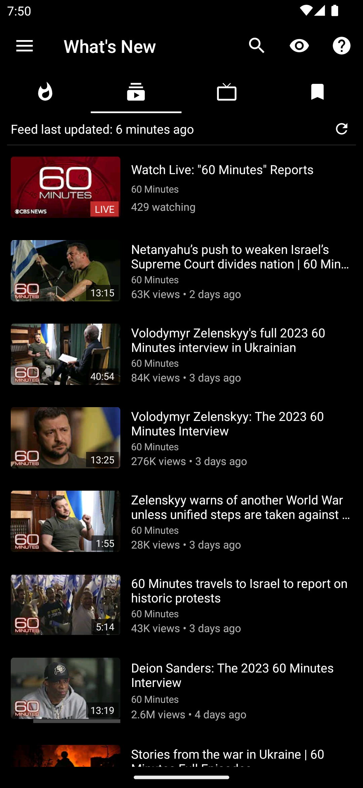
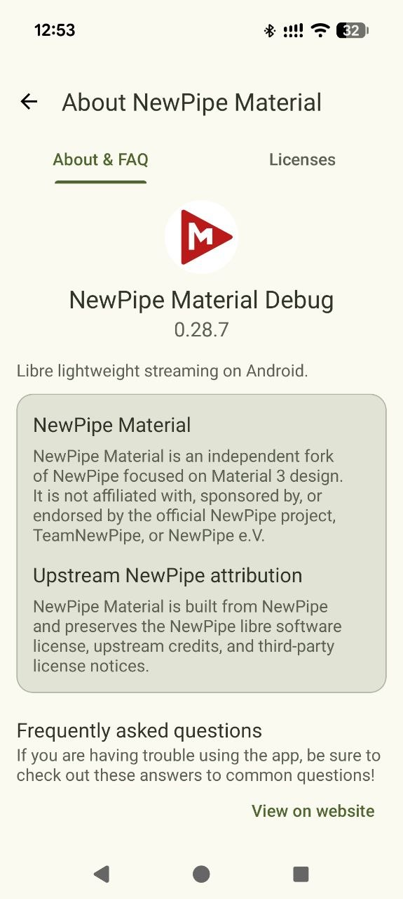
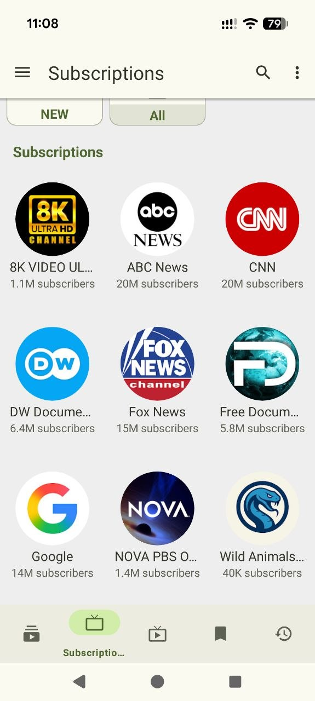
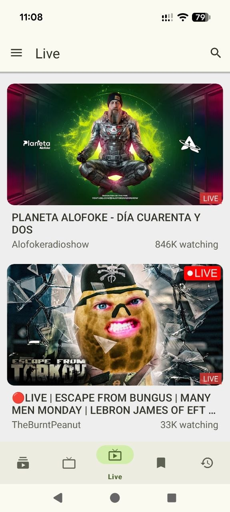
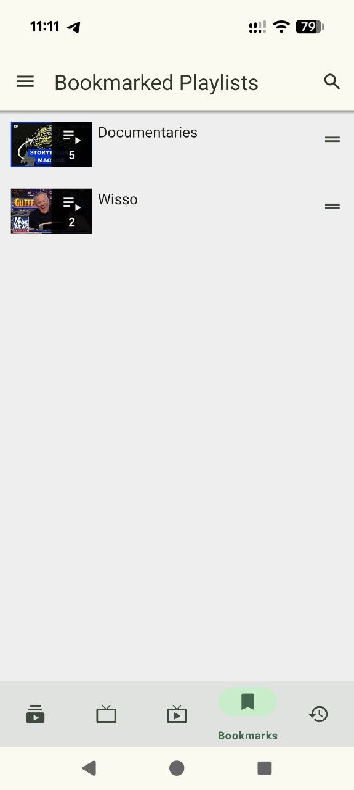
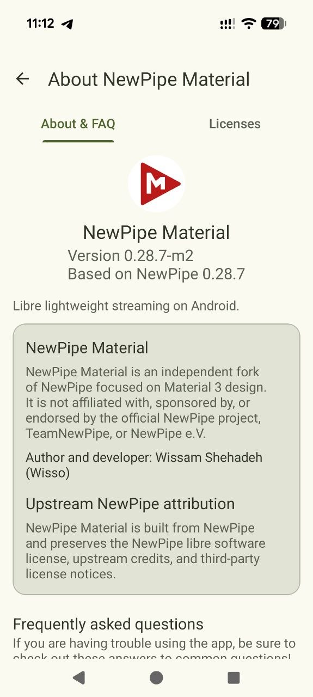
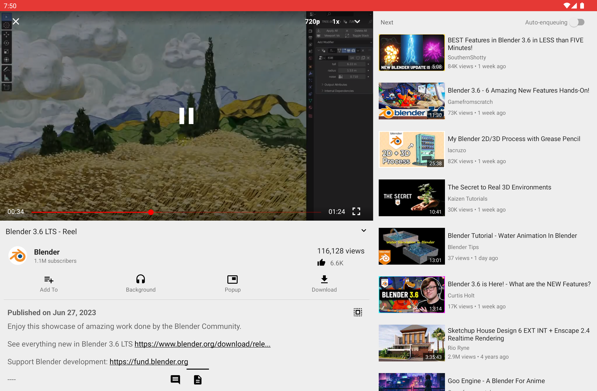
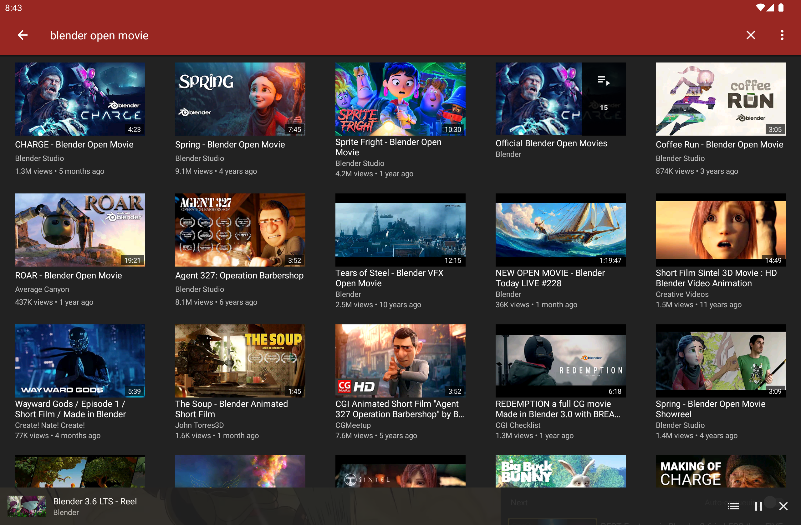

<p align="center"><a href="https://newpipe.net"></a></p> 
<h2 align="center"><b>NewPipe</b></h2>
<h4 align="center">A libre lightweight streaming front-end for Android.</h4>

<p align="center"><a href="https://f-droid.org/packages/org.schabi.newpipe/"></a></p>

<p align="center">
<a href="https://github.com/TeamNewPipe/NewPipe/releases" alt="GitHub NewPipe releases"></a>
<a href="https://github.com/TeamNewPipe/NewPipe-nightly/releases" alt="GitHub NewPipe nightly releases"></a>
<a href="https://www.gnu.org/licenses/gpl-3.0" alt="License: GPLv3"></a>
<a href="https://github.com/TeamNewPipe/NewPipe/actions" alt="Build Status"></a>
<a href="https://hosted.weblate.org/engage/newpipe/" alt="Translation Status"></a>
</p>

<p align="center">
<a href="https://web.libera.chat/#newpipe" alt="IRC channel: #newpipe"></a>
<a href="https://matrix.to/#/#newpipe:matrix.newpipe-ev.de" alt="Matrix channel: #newpipe"></a>
</p>

<hr>
<p align="center"><a href="#screenshots">Screenshots</a> &bull; <a href="#supported-services">Supported Services</a> &bull; <a href="#description">Description</a> &bull; <a href="#features">Features</a> &bull; <a href="#installation-and-updates">Installation and updates</a> &bull; <a href="#contribution">Contribution</a> &bull; <a href="#donate">Donate</a> &bull; <a href="#license">License</a></p>
<p align="center"><a href="https://newpipe.net">Website</a> &bull; <a href="https://newpipe.net/blog/">Blog</a> &bull; <a href="https://newpipe.net/FAQ/">FAQ</a> &bull; <a href="https://newpipe.net/press/">Press</a></p>
<hr>

*Ler este documento noutros idiomas: [Deutsch](/doc/README.de.md), [English](/doc/README.md),
[Español](/doc/README.es.md), [Français](/doc/README.fr.md), [हिन्दी](/doc/README.hi.md),
[Italiano](/doc/README.it.md), [한국어](/doc/README.ko.md), [Português Brasil](/doc/README.pt_BR.md),
[Polski](/doc/README.pl.md), [ਪੰਜਾਬੀ ](/doc/README.pa.md), [日本語](/doc/README.ja.md),
[Română](/doc/README.ro.md), [Soomaali](/doc/README.so.md), [Türkçe](/doc/README.tr.md),
[正體中文](/doc/README.zh_TW.md), [অসমীয়া](/doc/README.asm.md), [Српски](/doc/README.sr.md),
[العربية](/doc/README.ar.md)*

> [!warning]\
> <b>ESTA APP ESTÁ EM BETA, POR ISSO PODE ENCONTRAR ERROS. SE ISSO ACONTECER, ABRA UMA ISSUE NO
> NOSSO REPOSITÓRIO DO GITHUB, PREENCHENDO O MODELO DE ISSUE.</b>
> 
> <b>PUBLICAR O NEWPIPE, OU QUALQUER FORK DELE, NA GOOGLE PLAY STORE VIOLA OS TERMOS E CONDIÇÕES DA
> MESMA.</b>
> 
> <b>"NewPipe" É UMA MARCA NOMINATIVA REGISTADA, SUJEITA À [SUA POLÍTICA DE
> MARCA](https://newpipe-ev.de/policy/trademark/). NÃO SERÃO TOLERADAS APLICAÇÕES QUE A
> INFRINJAM.</b>

## Capturas de ecrã

[](/fastlane/metadata/android/en-US/images/phoneScreenshots/00.png)
[](/fastlane/metadata/android/en-US/images/phoneScreenshots/01.png)
[](/fastlane/metadata/android/en-US/images/phoneScreenshots/02.png)
[](/fastlane/metadata/android/en-US/images/phoneScreenshots/03.png)
[](/fastlane/metadata/android/en-US/images/phoneScreenshots/04.png)
[](/fastlane/metadata/android/en-US/images/phoneScreenshots/05.png)
[](/fastlane/metadata/android/en-US/images/phoneScreenshots/06.png)
[](/fastlane/metadata/android/en-US/images/phoneScreenshots/07.png)
[](/fastlane/metadata/android/en-US/images/phoneScreenshots/08.png)
<br/><br/>\
[](/fastlane/metadata/android/en-US/images/tenInchScreenshots/09.png)
[](/fastlane/metadata/android/en-US/images/tenInchScreenshots/10.png)

### Serviços suportados

Atualmente, o NewPipe suporta estes serviços:

<!-- We link to the service websites separately to avoid people accidentally opening a website they didn't want to. -->
* YouTube ([site](https://www.youtube.com/)) e YouTube Music ([site](https://music.youtube.com/))
  ([wiki](https://en.wikipedia.org/wiki/YouTube))
* PeerTube ([site](https://joinpeertube.org/)) e todas as suas instâncias (abra o site para saber o
  que isso significa!) ([wiki](https://en.wikipedia.org/wiki/PeerTube))
* Bandcamp ([site](https://bandcamp.com/)) ([wiki](https://en.wikipedia.org/wiki/Bandcamp))
* SoundCloud ([site](https://soundcloud.com/)) ([wiki](https://en.wikipedia.org/wiki/SoundCloud))
* media.ccc.de ([site](https://media.ccc.de/))
  ([wiki](https://en.wikipedia.org/wiki/Chaos_Computer_Club))

Como pode ver, o NewPipe suporta vários serviços de vídeo e áudio. Embora tenha começado com o
YouTube, ao longo dos anos outras pessoas foram adicionando mais serviços, tornando o NewPipe cada
vez mais versátil!

Em parte devido às circunstâncias e em parte devido à sua popularidade, o YouTube é o serviço com
melhor suporte. Se utiliza ou conhece algum dos outros serviços, ajude-nos a melhorar o suporte para
eles! Procuramos mantenedores para o SoundCloud e o PeerTube.

Se pretende adicionar um novo serviço, contacte-nos primeiro! A nossa
[documentação](https://teamnewpipe.github.io/documentation/) dá mais informações sobre como
adicionar um novo serviço à app e ao [NewPipe
Extractor](https://github.com/TeamNewPipe/NewPipeExtractor).

## Descrição

O NewPipe funciona obtendo os dados necessários a partir da API oficial (por exemplo, PeerTube) do
serviço que está a utilizar. Se a API oficial for restrita para os nossos fins (por exemplo,
YouTube) ou for proprietária, a app analisa o site ou utiliza uma API interna. Isto significa que
não precisa de conta em nenhum serviço para utilizar o NewPipe.

Além disso, como são software livre e de código aberto, nem a app nem o Extractor utilizam
bibliotecas ou frameworks proprietários, como os Google Play Services. Isto significa que pode
utilizar o NewPipe em dispositivos ou ROMs personalizadas que não tenham as apps da Google
instaladas.

### Funcionalidades

* Ver vídeos em resoluções até 4K
* Ouvir áudio em segundo plano, carregando apenas a stream de áudio para poupar dados
* Modo popup (reprodutor flutuante, também conhecido como Picture-in-Picture)
* Ver transmissões em direto
* Mostrar/ocultar legendas
* Pesquisar vídeos e áudios (no YouTube, também pode especificar o idioma do conteúdo)
* Colocar vídeos em fila (e, opcionalmente, guardá-los como listas de reprodução locais)
* Mostrar/ocultar informações gerais sobre os vídeos (como a descrição e as etiquetas)
* Mostrar/ocultar vídeos seguintes/relacionados
* Mostrar/ocultar comentários
* Pesquisar vídeos, áudios, canais, listas de reprodução e álbuns
* Explorar vídeos e áudios de um canal
* Subscrever canais (sim, sem iniciar sessão em nenhuma conta!)
* Receber notificações sobre novos vídeos dos canais que subscreve
* Criar e editar grupos de canais (para facilitar a navegação e a gestão)
* Explorar feeds de vídeos gerados a partir dos seus grupos de canais
* Ver e pesquisar o seu histórico de visualizações
* Pesquisar e ver listas de reprodução (são listas remotas, ou seja, obtidas a partir do serviço que
  está a explorar)
* Criar e editar listas de reprodução locais (são criadas e guardadas na app e não têm nada a ver
  com nenhum serviço)
* Transferir vídeos/áudios/legendas
* Abrir no Kodi
* Ver/bloquear conteúdo com restrição de idade

<!-- Hidden span to keep old links compatible. You should remove this span if you're translating the README into another language.-->
<span id="updates"></span>

## Instalação e atualizações
Pode instalar o NewPipe através de um dos seguintes métodos:
 1. Adicione o nosso repositório personalizado ao F-Droid e instale a partir daí. As instruções
    estão aqui: https://newpipe.net/FAQ/tutorials/install-add-fdroid-repo/
 2. Transfira o APK a partir das [GitHub Releases](https://github.com/TeamNewPipe/NewPipe/releases),
    [compare a chave de assinatura](#apk-info) e instale-o.
 3. Atualize através do F-Droid. É o método mais lento para receber atualizações, pois o F-Droid tem
    de detetar as alterações, compilar o próprio APK, assiná-lo e só depois enviar a atualização aos
    utilizadores.
 4. Compile um APK de depuração por si próprio. É a forma mais rápida de ter novas funcionalidades
    no seu dispositivo, mas é muito mais complicada, por isso recomendamos um dos outros métodos.
 5. Se estiver interessado numa funcionalidade ou correção específica disponibilizada num Pull
    Request deste repositório, também pode transferir o respetivo APK a partir do próprio PR. Leia a
    descrição do PR para ver as instruções. A grande vantagem dos APKs específicos de PRs é que são
    instalados lado a lado com a app oficial, por isso não precisa de se preocupar em perder os seus
    dados ou estragar alguma coisa.

Recomendamos o método 1 para a maioria dos utilizadores. Os APKs instalados através do método 1 ou 2
são compatíveis entre si (ou seja, se instalou o NewPipe através do método 1 ou 2, também o pode
atualizar através do outro), mas não com os instalados através do método 3. Isto deve-se ao facto de
ser usada a mesma chave de assinatura (a nossa) nos métodos 1 e 2, mas uma chave diferente (a do
F-Droid) no método 3. Compilar um APK de depuração através do método 4 dispensa totalmente a chave.
As chaves de assinatura ajudam a garantir que um utilizador não é enganado e levado a instalar uma
atualização maliciosa de uma app. Com o método 5, cada APK é assinado com uma chave aleatória
diferente fornecida pelo GitHub Actions, pelo que nem sequer o pode atualizar. Terá de fazer uma
cópia de segurança e restaurar os dados da app sempre que quiser usar um novo APK.

Entretanto, se por algum motivo quiser mudar de fonte (por exemplo, a funcionalidade principal do
NewPipe deixou de funcionar e o F-Droid ainda não tem a atualização mais recente), recomendamos este
procedimento:
1. Faça uma cópia de segurança dos seus dados em Definições > Cópia de segurança e restauro >
   Exportar base de dados, para manter o histórico, as subscrições e as listas de reprodução
2. Desinstale o NewPipe
3. Transfira o APK da nova fonte e instale-o
4. Importe os dados do passo 1 em Definições > Cópia de segurança e restauro > Importar base de
   dados

> [!Note] Quando importar uma base de dados para a app oficial, certifique-se sempre de que é a que
> exportou _a partir_ da app oficial. Se importar uma base de dados exportada de um APK que não seja
> a app oficial, poderá estragar algo. Esta ação não é suportada e só a deve fazer quando tiver a
> certeza absoluta do que está a fazer.

### Informações do APK

Esta é a impressão digital SHA da chave de assinatura do NewPipe, para verificar os APKs
transferidos que são assinados por nós. A impressão digital também está disponível no [site do
NewPipe](https://newpipe.net#download). Isto é relevante para o método 2.
```
CB:84:06:9B:D6:81:16:BA:FA:E5:EE:4E:E5:B0:8A:56:7A:A6:D8:98:40:4E:7C:B1:2F:9E:75:6D:F5:CF:5C:AB
```

## Contribuir
Quer tenha ideias, traduções, alterações de design, limpeza de código ou até grandes alterações de
código, a ajuda é sempre bem-vinda. A app fica cada vez melhor com cada contribuição, seja ela
grande ou pequena! Se quiser participar, consulte as nossas [notas de
contribuição](/.github/CONTRIBUTING.md).

<a href="https://hosted.weblate.org/engage/newpipe/">

</a>

## Doar
Se gosta do NewPipe, pode enviar um donativo. Preferimos o Liberapay, por ser de código aberto e sem
fins lucrativos. Para mais informações sobre como doar ao NewPipe, visite o nosso
[site](https://newpipe.net/donate).

<table>
  <tr>
    <td><a href="https://liberapay.com/TeamNewPipe/"></a></td>
    <td><a href="https://liberapay.com/TeamNewPipe/"></a></td>
    <td><a href="https://liberapay.com/TeamNewPipe/donate"></a></td>
  </tr>
</table>

## Política de privacidade

O projeto NewPipe pretende proporcionar uma experiência privada e anónima na utilização de serviços
multimédia baseados na web. Por isso, a app não recolhe quaisquer dados sem o seu consentimento. A
política de privacidade do NewPipe explica em detalhe que dados são enviados e guardados quando
envia um relatório de erro ou deixa um comentário no nosso blogue. Pode consultar o documento
[aqui](https://newpipe.net/legal/privacy/).

## Licença
[](https://www.gnu.org/licenses/gpl-3.0.en.html)

O NewPipe é Software Livre: pode usá-lo, estudá-lo, partilhá-lo e melhorá-lo à vontade.
Especificamente, pode redistribuí-lo e/ou modificá-lo nos termos da [Licença Pública Geral
GNU](https://www.gnu.org/licenses/gpl.html), tal como publicada pela Free Software Foundation, quer
a versão 3 da Licença, quer (à sua escolha) qualquer versão posterior.
