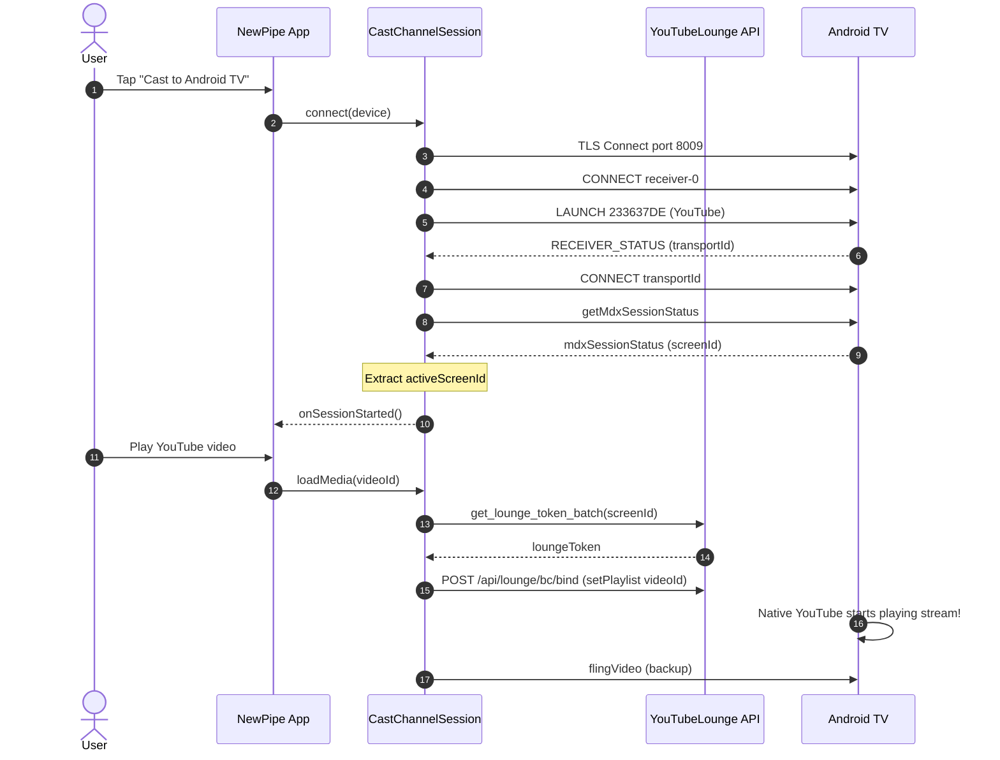

# Design Specification: Android TV Search Reactive Pipeline & Google Cast Playback Bridge

**Date**: 2026-10-14  
**Status**: Approved by User  
**Target Project**: [TeamNewPipe/NewPipe](https://github.com/TeamNewPipe/NewPipe)  
**Branch**: `feat/foss-google-cast`  
**License Compliance**: 100% FOSS / F-Droid Compliant (GPL-3.0-or-later)  

---

## 1. Overview & Objectives

This specification addresses two interrelated functional issues reported on Android TV and Google Cast integration:
1. **Android TV Search**: Typing in the Leanback search bar fails to return results because `TvSearchFragment.onQueryTextChange` is a no-op, and TV keyboards rarely emit an explicit submit action. Microphone voice search fails due to missing permissions.
2. **Google Cast to Android TV**: When connecting to an Android TV via Google Cast, the UI displays "Connected" / "Casting to [TV]", but playback never begins on the TV because the modern YouTube receiver requires an MDX session handshake (`screenId` -> `loungeToken` -> Lounge bind) rather than a naked `flingVideo` command.

---

## 2. Architecture & Detailed Design

### 2.1 Android TV Search Reactive Pipeline (`TvSearchFragment.java`)

#### A. Debounced Reactive Query Stream
- Introduce a RxJava 3 `PublishSubject<String> searchSubject`.
- In `onCreate`, bind `searchSubject` with:
  ```java
  disposables.add(searchSubject
      .debounce(400, TimeUnit.MILLISECONDS)
      .map(String::trim)
      .distinctUntilChanged()
      .observeOn(AndroidSchedulers.mainThread())
      .subscribe(this::handleQueryChange, throwable -> Log.e(TAG, "Search query error", throwable)));
  ```
- In `onQueryTextChange(String newQuery)`:
  - If `newQuery == null` or trimmed query is empty, immediately clear all result adapters (`videoResultsAdapter`, `channelResultsAdapter`, `playlistResultsAdapter`, `rowsAdapter`).
  - Otherwise, emit `newQuery` into `searchSubject`.
- In `onQueryTextSubmit(String query)`:
  - If query is non-empty, immediately trigger `performSearch(query.trim())` without waiting for the 400ms debounce.

#### B. Dynamic Result Rows Allocation
- Instead of statically mounting 3 empty header rows (`Channels`, `Videos`, `Playlists`) on initial launch, rebuild or update `rowsAdapter` dynamically in `onSearchResultsLoaded(SearchInfo searchInfo)`:
  - Header `getString(R.string.channel)` is added only if `channelResultsAdapter.size() > 0`.
  - Header `getString(R.string.videos_string)` is added only if `videoResultsAdapter.size() > 0`.
  - Header `getString(R.string.playlists)` is added only if `playlistResultsAdapter.size() > 0`.
- This ensures clean visual hierarchy without orphaned empty category headers.

#### C. Click Handling for Playlists
- In `onItemClicked(...)`, add explicit handling for `PlaylistInfoItem`:
  - Extract service ID and playlist URL.
  - Route to playlist details or stream queue playback via `TvNavigationHelper`.

#### D. Voice Search & Audio Permissions
- In `app/src/main/AndroidManifest.xml`:
  - Add `<uses-permission android:name="android.permission.RECORD_AUDIO" />`.
  - Add `<uses-feature android:name="android.hardware.microphone" android:required="false" />`.
- In `TvSearchFragment.java`:
  - Check `SpeechRecognizer.isRecognitionAvailable(requireContext())` and check `RECORD_AUDIO` permission before invoking voice search callbacks, preventing crashes on devices without speech engines or hardware microphones.

---

### 2.2 Google Cast MDX Session Handshake & Dual Playback Bridge

### A. MDX Session Handshake in `CastChannelSession.kt`
1. **Status Query**:
   - Upon launching `APP_ID_YOUTUBE` (`233637DE`), send `{"type": "getMdxSessionStatus"}` on `urn:x-cast:com.google.youtube.mdx`.
2. **Response Interception**:
   - In `handleIncomingMessage`:
     ```kotlin
     "mdxSessionStatus" -> handleMdxSessionStatus(json)
     ```
   - Extract `screenId` from `json.optString("screenId")` or `json.optJSONObject("data")?.optString("screenId")`.
   - Store as `activeScreenId`.
3. **Lounge Token Resolution & Playback Dispatch**:
   - When `sendMediaRequest` is called for YouTube media:
     - If `activeScreenId` is present:
       - Fetch `loungeToken` via `https://www.youtube.com/api/lounge/pairing/get_lounge_token_batch`.
       - Create an internal `LoungeSession` or dispatch `setPlaylist` with `videoId` to `https://www.youtube.com/api/lounge/bc/bind`.
     - In parallel, also send the `flingVideo` payload over `urn:x-cast:com.google.youtube.mdx` for legacy Chromecast dongles.

### B. Universal Default Media Receiver (`CC1AD845`) Fallback
- For non-YouTube sources (PeerTube, SoundCloud, Bandcamp) or if `APP_ID_YOUTUBE` returns `LAUNCH_ERROR`:
  - Switch `targetAppId` to `APP_ID_DEFAULT_MEDIA_RECEIVER` (`CC1AD845`).
  - Dispatch direct stream media (HLS URL or progressive MP4 URL) via `LOAD` on `urn:x-cast:com.google.cast.media`.

### C. Multicast Lock in `YouTubeLoungeDriver.kt`
- In `app/src/main/AndroidManifest.xml`:
  - Add `<uses-permission android:name="android.permission.CHANGE_WIFI_MULTICAST_STATE" />`.
- In `YouTubeLoungeDriver.kt`:
  - Acquire `WifiManager.MulticastLock` before opening the `DatagramSocket` in `startDiscovery()`.
  - Release `MulticastLock` cleanly in `stopDiscovery()`.

---

## 3. Data Flow & Sequence Diagram



---

## 4. Verification Plan

### 4.1 Automated Tests
- `TvSearchFragmentTest`: Test `searchSubject` emits debounced queries and clears results on blank input.
- `CastChannelSessionTest`: Mock `mdxSessionStatus` message and verify `activeScreenId` is extracted and used to bind playback.

### 4.2 Manual Verification
1. **TV Search**:
   - Open Leanback TV UI on emulator or TV device.
   - Navigate to Search. Type query characters "NewPipe".
   - Confirm search results load automatically within 400ms after user pauses typing.
   - Clear search text; verify results rows are dismissed cleanly.
2. **Cast Playback**:
   - Open phone UI connected to local Wi-Fi with Android TV.
   - Tap Cast button -> select Android TV.
   - Play any video. Confirm Android TV launches playback immediately on screen.
